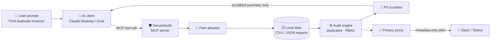

<div align="center">

# 🛡️ SecureAudit MCP

**Let an AI audit your financial data without the data ever leaving your machine.**
A privacy-first Model Context Protocol (MCP) server that finds duplicate invoices and risky access changes, scrubs PII from every result, and sends metadata-only alerts.

<p>
  <a href="https://github.com/achux11/secureaudit-mcp/actions/workflows/ci.yml"></a>
  
  
  
  
</p>

<sub>Course team project · <i>The Buzz Lightyears</i> · 📊 <a href="docs/SecureAudit_AI_Slides.pptx">Project slides</a></sub>

</div>

---

## 🤔 The problem

Auditors want AI to spot fraud and control gaps, but sending raw invoices, emails and account numbers to a cloud model is a privacy and compliance risk (GDPR, CCPA, SOC 2).

**SecureAudit flips it: bring the compute to the data, not the data to the compute.** The audit runs locally, and the AI only ever sees scrubbed, summarized results.

> **You (in Claude Desktop):** Find duplicate invoices in Q3.
> **SecureAudit:** 2 duplicate groups across the ERP and legacy billing exports. `VEND-ACME-01` billed $1,200.50 on 2024-07-15 **three times**. Emails and account numbers are redacted.

## ✨ Features

<table>
  <tr>
    <td width="50%" valign="top">
      <h3>🧾 Duplicate invoice detection</h3>
      Normalizes two different export formats (ERP and legacy billing) and matches on vendor, amount and date to catch the same bill paid in both systems.
    </td>
    <td width="50%" valign="top">
      <h3>🔐 Access-control (RBAC) checks</h3>
      Flags SOC 2-style gaps: superuser access granted to an outside domain, and sensitive roles granted with no change ticket.
    </td>
  </tr>
  <tr>
    <td width="50%" valign="top">
      <h3>🧽 PII scrubbing</h3>
      Every tool output is redacted for emails, card numbers, SSNs, IBANs and long account numbers before an AI model can see it.
    </td>
    <td width="50%" valign="top">
      <h3>📣 Privacy-gated alerts</h3>
      A privacy proxy only lets compact, metadata-only alerts out to Slack or Teams webhooks, and blocks any payload that still looks like PII. Dry run by default.
    </td>
  </tr>
  <tr>
    <td width="50%" valign="top">
      <h3>📂 Path allowlist</h3>
      Tools can only read files inside your data folder, so a prompt can't trick the AI into reading <code>/etc/passwd</code> or your home directory.
    </td>
    <td width="50%" valign="top">
      <h3>🖥️ Local dashboard</h3>
      A FastAPI web app (bound to localhost only) runs the same audits with one click, for people who don't use an MCP client.
    </td>
  </tr>
</table>

## 🧠 How it works



## 🧰 MCP tools & resources

| Tool | What it does |
|---|---|
| `audit_duplicate_invoices` | Finds the same bill across separate CSV exports |
| `audit_rbac_anomalies` | Flags risky permission grants in an access log |
| `scrub_text_preview` | Returns a PII-redacted copy of any text |
| `read_local_dataset_preview` | Shows the first few lines of a file, scrubbed, so the AI can learn its structure |
| `send_compliance_alert` | Sends a metadata-only alert through the privacy proxy |

**Resources:** `secureaudit://manifest` (available datasets) · `secureaudit://policy/data-handling` · `secureaudit://schemas/transactions_csv`

## 📊 Results on the sample data

| Check | Result |
|---|---|
| Rows loaded across 2 billing systems | **8** |
| Cross-system duplicate invoice groups | **2** (ACME $1,200.50 billed 3×, NORTH $5,000.00 billed 2×) |
| Access-log events scanned | **4** |
| Control-gap findings | **3** (1 critical external superuser, 2 missing change tickets) |
| Emails / account numbers reaching the AI | **0** (all redacted) |

## 🚀 Quick start

**macOS / Linux**
```bash
git clone https://github.com/achux11/secureaudit-mcp.git
cd secureaudit-mcp
./start.sh                      # creates .venv, installs, opens http://127.0.0.1:8750
```

**Windows:** double-click `start.bat` (or run `start.ps1`).

**Command-line demo** (no AI client needed):
```bash
python -m venv .venv && source .venv/bin/activate
pip install -e .
secureaudit-demo
```

## 🔌 Connect it to Claude Desktop

Add this to your Claude Desktop config (`claude_desktop_config.json`), then restart Claude:

```json
{
  "mcpServers": {
    "secureaudit": {
      "command": "/full/path/to/secureaudit-mcp/.venv/bin/python",
      "args": ["-m", "secureaudit"]
    }
  }
}
```

Then ask: *"Use SecureAudit to find duplicate invoices and risky access changes."* On Windows, point `command` at `.venv\Scripts\python.exe`.

## ⚙️ Configuration

| Variable | Purpose |
|---|---|
| `SECUREAUDIT_DATA_ROOT` | Folder with your CSV/JSON exports (default: `sample_data/`) |
| `SECUREAUDIT_ALLOW_ANY_PATH` | Set to `1` to allow reads outside the data root (**use carefully**) |
| `SECUREAUDIT_WEBHOOK_URL` | Default Slack/Teams webhook for alerts |
| `SECUREAUDIT_WEBHOOK_SECRET` | Optional `Authorization: Bearer …` header |
| `SECUREAUDIT_PORT` | Dashboard port (default `8750`) |

## ✅ Tests

```bash
pip install -e . pytest
pytest -q
```

13 tests cover the audit engine, PII scrubbing, the privacy proxy, the path allowlist, the dashboard API, and an **end-to-end MCP test** that starts the server and calls its tools the way an AI client would. They run on every push via GitHub Actions.

## 📁 Project structure

```
secureaudit-mcp/
├── secureaudit/
│   ├── server.py          # 🛡️ MCP server: tools + resources
│   ├── audit_engine.py    # ⚙️ duplicate-invoice + RBAC logic
│   ├── pii.py             # 🧽 regex PII scrubbing
│   ├── privacy_proxy.py   # 📣 metadata-only alert builder + outbound check
│   ├── alerts.py          # 🔗 webhook delivery
│   ├── paths.py           # 📂 data-root allowlist
│   ├── scans.py           # 🔄 shared scan orchestration
│   ├── webapp.py          # 🖥️ FastAPI dashboard + REST API
│   ├── demo.py            # ▶️ CLI demo
│   └── static/            # dashboard HTML / CSS / JS
├── sample_data/           # demo ERP, legacy billing, and access-log exports
├── tests/                 # pytest suite (unit, API, end-to-end MCP)
├── docs/                  # project slides
└── start.sh · start.bat · start.ps1
```

## 🔭 Limitations & next steps

- [ ] PII scrubbing is regex-based; production use needs a dedicated DLP / PHI-detection service
- [ ] Duplicate matching is exact on (vendor, amount, date); fuzzy matching would catch near-duplicates
- [ ] Field mappings are built for the two sample export formats; real ERPs need configurable mappings
- [ ] Send findings to a SIEM or ticketing system instead of only chat webhooks

---

<div align="center">
<sub>Built by <i>The Buzz Lightyears</i> · Maintained by <a href="https://github.com/achux11">Achintya Vamshi Nudurupati</a> · <a href="https://linkedin.com/in/achintya11">LinkedIn</a></sub>
</div>
